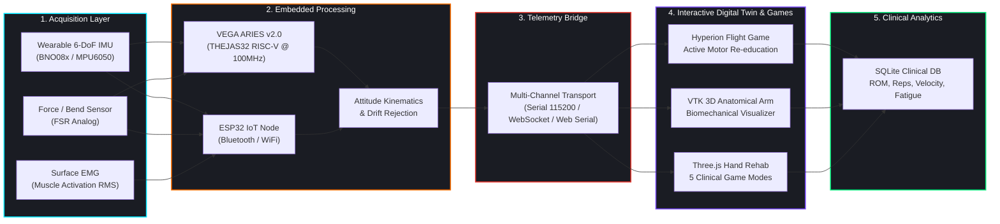

<div align="center">

# 🦾 RehabiHand & Hyperion: Gamified Neuro-Rehabilitation Platform
### *Intelligent, Sensor-Driven Upper-Limb Rehabilitation Powered by Embedded Systems*

<!-- Animated Moving / Typing SVG Banner -->
<a href="https://github.com/Deepak-prog15/gamified-rehabilitation-system-aries-board-v2">
  
</a>

<p align="center">
  
  
  
  
  
  
</p>

```
  ┌─────────────────┐       ┌──────────────────────┐       ┌──────────────────────┐       ┌──────────────────────┐       ┌──────────────────────┐
  │  Patient Arm    │  ──►  │  VEGA ARIES RISC-V   │  ──►  │ Real-Time Telemetry  │  ──►  │ 3D Digital Twin Arm  │  ──►  │ Clinical Biofeedback │
  │ Wearable Sensors│       │ Hardware DSP & IMU   │       │ Bridge (Serial / WS) │       │ & Hyperion Flight    │       │ & ROM Recovery Score │
  └─────────────────┘       └──────────────────────┘       └──────────────────────┘       └──────────────────────┘       └──────────────────────┘
   [ 6-DoF IMU+EMG ]             [ THEJAS32 SoC ]               [ 50Hz Stream ]               [ PyQt5 + Ursina ]             [ Objective Metrics ]
```

<p align="center">
  <code><b>REAL-TIME KINEMATICS</b></code> &nbsp;•&nbsp;
  <code><b>INDIGENOUS RISC-V CORE</b></code> &nbsp;•&nbsp;
  <code><b>DIGITAL TWIN TRACKING</b></code> &nbsp;•&nbsp;
  <code><b>OBJECTIVE RECOVERY METRICS</b></code>
</p>

---

</div>

## 📑 Table of Contents

- [The Problem Statement](#-the-problem-statement)
- [The Solution & Engineering Approach](#-the-solution--engineering-approach)
- [System Architecture](#-system-architecture)
- [Main Modules & Features](#-main-modules--features)
  - [1. RehabiHand — Web 3D Hand Therapy](#1-rehabihand--browser-3d-hand-rehabilitation)
  - [2. 3D Arm Kinematic Tracker](#2-3d-arm-tracker-web-serial)
  - [3. Python Desktop Suite & Hyperion Squadron](#3-python-desktop-suite--hyperion-squadron-flight-game)
  - [4. C-DAC VEGA ARIES RISC-V Firmware](#4-c-dac-vega-aries-v20-thejas32-risc-v-firmware)
  - [5. ESP32 Sensor & Telemetry Firmware](#5-esp32-sensor--wireless-trainer-firmware)
- [Hardware Interfacing & Pinouts](#-hardware-interfacing--pinout-configuration)
- [Sensor Telemetry & Data Formats](#-sensor-telemetry--data-communication)
- [Repository Structure](#-repository-structure)
- [Getting Started & Installation](#-getting-started)
- [Troubleshooting Matrix](#-troubleshooting-matrix)
- [Project Maintainers & Acknowledgements](#-project-maintainers--acknowledgements)
- [Medical Disclaimer](#-safety-and-medical-disclaimer)

---

## 🚨 The Problem Statement

Post-stroke hemiparesis, traumatic brain injuries (TBI), and orthopedic joint traumas leave millions of patients with severely impaired upper-extremity motor function. Conventional physical therapy faces critical bottlenecks:

1. **Monotonous & Demotivating Regimes**: Traditional physical therapy requires hundreds of daily repetitive joint extensions, leading to high patient attrition (>60%) and poor compliance.
2. **Subjective & Unquantified Assessment**: Clinicians rely on qualitative visual observation or manual goniometers, failing to capture subtle tremors, joint velocity fluctuations, and compensatory shoulder elevation.
3. **Prohibitive Cost & Access Inequity**: Specialized robotic rehabilitation exoskeletons cost upwards of \$50,000, confining high-frequency therapy to specialized clinical centers and preventing accessible home-based rehabilitation.

---

## 💡 The Solution & Engineering Approach

The **Gamified Neuro-Rehabilitation Platform** bridges wearable biomedical hardware with real-time gamification and anatomical digital twins. Built upon India's indigenous **C-DAC VEGA ARIES v2.0 (THEJAS32 RISC-V)** platform and complemented by **ESP32** telemetry, this system turns physical therapy into an engaging, quantified recovery journey:

| Challenge | Engineering Approach |
| :--- | :--- |
| **Repetitive exercise monotony** | Dynamic 3D game engines (Hyperion Flight & Marble Maze) with score, level, and combo mechanics |
| **Invisible joint kinematics** | 3D anatomical arm and articulated hand digital twins mirroring real-time joint positions |
| **Unquantified muscle effort** | Dual-sensing with BNO08x/MPU6050 IMUs, Force-Sensing Resistors (FSR), and EMG RMS signal processing |
| **Lack of immediate feedback** | Sub-20ms visual indicators, procedural audio feedback, and haptic vibration guidance |
| **Multi-platform accessibility** | Native Python/VTK desktop clinical suite alongside browser-based Three.js web apps |

---

## ⚡ System Architecture



---

## 🎮 Main Modules & Features

### 1. RehabiHand — Browser 3D Hand Rehabilitation
**Path:** `hand_rehab/`  
An interactive 3D browser application powered by **Three.js** that connects physical finger flexion and grip sensors to a real-time articulated hand model.

* **Articulated Hand Model:** Palm, wrist, and five independently articulated 3-joint finger groups.
* **Five Clinical Game Modes:**
  1. 🎯 **Range of Motion (ROM):** Target finger positioning and active joint extension.
  2. ✊ **Grip Strength:** Reaching target muscular/force thresholds.
  3. 🔄 **Coordination:** Timed gesture sequences to retrain neuromuscular pathways.
  4. 📦 **Object Manipulation:** Fine-motor virtual object grasping and moving.
  5. ⏱️ **Endurance:** Progressive fatigue-managed repetitive open/close cycles.
* **Gamification:** Levels, achievement badges, real-time auditory biofeedback, and browser local storage persistence.

### 2. 3D Arm Tracker (Web Serial)
**Path:** `arm_tracker/`  
A lightweight browser-based kinematics visualizer using the **HTML5 Web Serial API** at 115200 baud. Allows instant zero-install testing directly in Chrome or Edge.

### 3. Python Desktop Suite & Hyperion Squadron Flight Game
**Path:** `rehab_system/`  
The clinical desktop workstation built with **PyQt5** and **VTK**:
* **Hyperion Squadron 3D:** High-octane space flight rehabilitation game built with Ursina. Arm pitch controls altitude, roll controls banking through celestial score rings, and hand grip fires laser countermeasures.
* **VTK Biomechanical Arm:** Concurrent anatomical digital twin with real-time shoulder, humerus, and forearm rendering.
* **Clinical Database:** Embedded SQLite storage (`hyp_clinical.db`) tracking session duration, max flexion/extension degrees, repetition counts, and velocity curves.

### 4. C-DAC VEGA ARIES v2.0 (THEJAS32 RISC-V) Firmware
**Path:** `vega_aries_firmware/`  
* Tailored for India's indigenous **THEJAS32 32-bit RISC-V** SoC running at 100MHz.
* Features native I2C sensor scanning, BNO08x register validation benches, and real-time bicep curl kinematics calculation.

### 5. ESP32 Sensor & Wireless Trainer Firmware
**Path:** `esp32_firmware/`  
* **Bluetooth Classic Serial** broadcasting under the identifier `ReflexAI-Trainer`.
* **Sensor Fusion:** BNO08x 6-DoF orientation, EMG root-mean-square (RMS) muscle activation, FSR bend/grip analysis, and haptic motor feedback.

---

## 🔬 Hardware Interfacing & Pinout Configuration

### C-DAC VEGA ARIES v2.0 (THEJAS32 RISC-V)

| Sensor Signal | VEGA ARIES v2.0 Pin | Description |
| :--- | :--- | :--- |
| **VCC** | `3V3 / 5V` | Regulated Power Supply |
| **GND** | `GND` | Ground Reference |
| **I2C SCL** | `SCL (Pin 19)` | Hardware I2C Clock (Fast Mode 400kHz) |
| **I2C SDA** | `SDA (Pin 18)` | Hardware I2C Data Line |
| **Force FSR / Grip** | `A0` | Analog Input (ADC 10-bit) |

### ESP32 Microcontroller

| Sensor Signal | ESP32 Pin | Function |
| :--- | :--- | :--- |
| **EMG Analog Input** | `GPIO 35` | Muscle Activation Signal (ADC) |
| **Force / Bend Sensor** | `GPIO 32` | Grip / Flex Resistance (ADC) |
| **BNO08x SDA** | `GPIO 21` | Hardware I2C Data |
| **BNO08x SCL** | `GPIO 22` | Hardware I2C Clock |
| **Haptic Motor Output** | `GPIO 26` | Tactile Vibration Feedback |

---

## 📡 Sensor Telemetry & Data Communication

### 1. ESP32 Serial & Bluetooth JSON Stream
Emitted at **115200 baud** as newline-delimited JSON packets:
```json
{
  "imuConnected": true,
  "isCalibrated": true,
  "roll": 12.45,
  "pitch": -5.32,
  "yaw": 88.10,
  "emgValue": 512,
  "emgRms": 48.6,
  "emgFatigueLevel": 1,
  "muscleActivation": 0.65,
  "bendForce": 72.0,
  "elbowAngle": 94.2,
  "postureGood": true,
  "curlCount": 14
}
```

### 2. High-Speed WebSocket Telemetry (Port 81)
Compact JSON schema optimized for ultra-low latency web rendering:
```json
{
  "r": 12.4,
  "p": -5.3,
  "y": 88.1,
  "f": 72.0,
  "e": 512,
  "tc": 14,
  "gc": 12,
  "w": 0
}
```

---

## 📁 Repository Structure

```text
Rehabilitation-gamified-main/
├── requirements.txt             # Universal Python requirements manifest
├── README.md                    # Technical documentation & system manual
├── .gitignore                   # Version control filter
├── serial_monitor.py            # Diagnostic serial inspection script
├── ARIESv2 0_Datasheet_v2 .pdf  # Technical datasheet for ARIES v2.0 board
│
├── vega_aries_firmware/         # C-DAC VEGA ARIES (THEJAS32 RISC-V) Firmware
│   ├── bicep_curl_counter/      # Repetition counter with IMU kinematics
│   ├── bno08x_raw_test/         # BNO08x sensor validation test bench
│   └── vega_aries_i2c_scanner/  # I2C peripheral scanner for ARIES boards
│
├── esp32_firmware/              # ESP32 IoT Sensor Firmware
│   ├── arm_rehab_serial_imu/    # High-speed serial IMU stream
│   ├── arm_rehab_trainer/       # ReflexAI Bluetooth trainer sketch
│   ├── bicep_curl_counter/      # WebSocket-enabled bicep curl counter
│   ├── force_sensor_test/       # Analog force/flex sensor test bench
│   └── test_client/             # HTML WebSocket diagnostic test harness
│
├── rehab_system/                # Python Desktop Clinical Suite & 3D Games
│   ├── main_with_game.py        # Master GUI + 3D Arm + Flight Game launcher
│   ├── main.py                  # Standard PyQt5 workstation entry point
│   ├── START.bat                # Windows automated launch script
│   ├── exercises/               # Clinical exercise logic & ROM algorithms
│   ├── games/                   # Ursina space flight & clinical database modules
│   ├── models/                  # 3D anatomical arm & hand CAD models (.obj, .glb)
│   ├── sensors/                 # Telemetry clients (Serial, WebSocket, Simulator)
│   └── ui/                      # PyQt clinical dashboard & real-time telemetry graphs
│
├── hand_rehab/                  # Web-Based Hand Physiotherapy Interface (Three.js)
│   ├── index.html               # Main hand rehabilitation portal
│   ├── css/                     # Cyberpunk clinical theme stylesheets
│   └── js/                      # Scene manager, hand model, game engines, feedback
│
└── arm_tracker/                 # Web-Based Arm Kinematics Visualizer (Web Serial)
    └── index.html               # Zero-install Web Serial 3D viewer
```

---

## 🚀 Getting Started

### 1. Environment Setup

```bash
# Clone the repository
git clone https://github.com/Deepak-prog15/gamified-rehabilitation-system-aries-board-v2.git
cd gamified-rehabilitation-system-aries-board-v2

# Install dependencies
pip install -r requirements.txt
```

### 2. Flashing Embedded Firmware
* **VEGA ARIES v2.0:** Open `vega_aries_firmware/bicep_curl_counter/bicep_curl_counter.ino` in Arduino IDE with the VEGA ARIES board package installed. Select your COM port and upload.
* **ESP32:** Open `esp32_firmware/arm_rehab_trainer/arm_rehab_trainer.ino` in Arduino IDE, select **ESP32 Dev Module**, and flash.

### 3. Running the Applications

#### Option A: Python Desktop Application & 3D Flight Game
```bash
cd rehab_system
python main_with_game.py
# (Or double-click START.bat on Windows)
```

#### Option B: Browser 3D Hand Rehabilitation
```bash
cd hand_rehab
python -m http.server 8000
# Open http://localhost:8000 in Chrome / Edge
```

#### Option C: Web Serial Arm Tracker
```bash
cd arm_tracker
python -m http.server 8001
# Open http://localhost:8001 and select your connected COM port
```

---

## 🔧 Troubleshooting Matrix

| Symptom | Root Cause | Solution |
| :--- | :--- | :--- |
| **Serial port cannot be opened** | Another application holds COM port lock | Close Arduino Serial Monitor, Cura, or background Python instances |
| **BNO08x sensor not detected** | I2C address conflict or loose wire | Run `vega_aries_i2c_scanner.ino`; verify SDA/SCL pull-ups and 3.3V power |
| **Web Serial device picker missing** | Browser lacks Web Serial API support | Use Google Chrome or Microsoft Edge served via `localhost` or HTTPS |
| **No 3D scene in browser** | WebGL disabled or CDN script blocked | Open browser DevTools (F12) to verify Three.js and GSAP CDN loads |
| **Python GUI fails on launch** | Missing PyQt5 or VTK wheels | Run `pip install -r requirements.txt` inside an active Python virtual environment |
| **Hardware disconnected** | Testing without microcontrollers | Select **Simulator Mode** in the desktop application to test with synthetic sinusoidal kinematic waves |

---

## 👥 Project Maintainers & Acknowledgements

This multi-award-winning project was conceptualized, engineered, and developed by:

- 🏅 **Deepak** ([@Deepak-prog15](https://github.com/Deepak-prog15))
- 🏅 **Vishal R** ([@vishal-r07](https://github.com/vishal-r07))
- 🏅 **Kishore VS** ([@Kishore-VS](https://github.com/Kishore-VS))
- 🏅 **Ashwin R** ([@ashwinr-act-cit](https://github.com/ashwinr-act-cit))
- 🏅 **Loki I** ([@Loki-i](https://github.com/Loki-i))

### 🏆 Awards and Recognition
* **Winner of 2 National Hackathons** for innovations in accessible biomedical engineering, gamified neuro-rehabilitation, and indigenous RISC-V edge computing.

---

## ⚠️ Safety and Medical Disclaimer

This project is an engineering prototype developed for research, education, and hackathon demonstration purposes. **It is not an FDA-approved or CE-marked medical device.**
- All exercise regimes, angular limits, and repetitions should be configured under the supervision of a licensed physical therapist or medical clinician.
- Sensor-derived joint angles, EMG fatigue indices, and repetition counts are experimental metrics.
- Cease exercise immediately if discomfort, acute fatigue, or pain occurs.

---

<div align="center">
  <sub>Engineered with ❤️ for Indigenous Biomedical Innovation & Motor Recovery • C-DAC VEGA ARIES RISC-V</sub>
</div>
