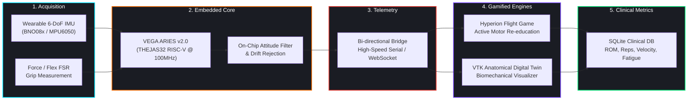

<div align="center">

# 🦾 Neuro-Rehab: Intelligent Gamified Upper-Extremity Motor Rehabilitation

<!-- Animated Moving / Typing SVG Banner -->
<a href="https://github.com/Deepak-prog15/gamified-rehabilitation-system-aries-board-v2">
  
</a>

<p align="center">
  
  
  
  
  
</p>

```
  ┌─────────────────┐       ┌──────────────────────┐       ┌──────────────────────┐       ┌──────────────────────┐       ┌──────────────────────┐
  │  Patient Arm    │  ──►  │  VEGA ARIES RISC-V   │  ──►  │ Real-Time Telemetry  │  ──►  │ 3D Digital Twin Arm  │  ──►  │ Clinical Biofeedback │
  │ Wearable Sensors│       │ Hardware DSP & IMU   │       │ Bridge (Serial / WS) │       │ & Hyperion Flight    │       │ & ROM Recovery Score │
  └─────────────────┘       └──────────────────────┘       └──────────────────────┘       └──────────────────────┘       └──────────────────────┘
      [ 6-DoF IMU ]              [ THEJAS32 SoC ]               [ 50Hz Stream ]               [ PyQt5 + Ursina ]             [ Objective Metrics ]
```

<p align="center">
  <code><b>REAL-TIME KINEMATICS</b></code> &nbsp;•&nbsp;
  <code><b>INDIGENOUS RISC-V CORE</b></code> &nbsp;•&nbsp;
  <code><b>DIGITAL TWIN TWIN-TRACKING</b></code> &nbsp;•&nbsp;
  <code><b>OBJECTIVE RECOVERY METRICS</b></code>
</p>

---

</div>

## 🚨 The Problem Statement

Post-stroke hemiparesis, traumatic brain injuries (TBI), and orthopedic joint traumas leave millions of patients with severely impaired upper-extremity motor function. Conventional physical therapy faces critical bottlenecks:

1. **Monotonous & Repetitive Regimes**: Traditional arm therapy requires hundreds of daily repetitive joint extensions, leading to high patient attrition (>60%) and poor compliance.
2. **Subjective & Unquantified Assessment**: Clinicians rely on qualitative visual observation or manual goniometers, failing to capture subtle tremors, joint velocity fluctuations, and compensatory shoulder elevation.
3. **Prohibitive Cost & Access Inequity**: Specialized robotic rehabilitation exoskeletons cost upwards of \$50,000, confining high-frequency therapy to specialized clinical centers and preventing accessible home-based rehabilitation.

---

## 💡 The Solution

The **Gamified Neuro-Rehabilitation System** bridges wearable biomedical hardware with real-time gamification and anatomical digital twins. Built upon India's indigenous **C-DAC VEGA ARIES v2.0 (THEJAS32 RISC-V)** platform and complemented by **ESP32** telemetry, this system turns physical therapy into an engaging, quantified recovery journey.

- **Dynamic Biofeedback**: Arm pronation, supination, flexion, and extension map directly to an agile spacecraft navigating cosmic asteroid fields and celestial portals.
- **Anatomical Digital Twin**: A concurrent VTK-powered 3D biomechanical arm mirrors the patient's exact anatomical posture in real time.
- **Automated Repetition & ROM Tracking**: Integrated algorithms count repetitions, detect fatigue, and log maximum Range of Motion (ROM) with sub-degree accuracy.

---

## ⚡ End-to-End System Pipeline



---

## 🔬 Hardware Architecture & Interfacing

### C-DAC VEGA ARIES v2.0 (THEJAS32 RISC-V)

The primary compute core leverages the indigenous **THEJAS32 32-bit RISC-V** SoC running at 100 MHz. The sensor communicates over high-speed hardware I2C with hardware-level timing determinism:

| Sensor Pin | VEGA ARIES v2.0 Pin | Description |
| :--- | :--- | :--- |
| **VCC** | `3V3 / 5V` | Regulated Logic Power |
| **GND** | `GND` | Ground Reference |
| **SCL** | `SCL (Pin 19)` | I2C Clock (Fast Mode 400kHz) |
| **SDA** | `SDA (Pin 18)` | I2C Data Line |
| **FSR Analog** | `A0` | Analog Force / Grip Sensor Input |

---

## 🎮 Gamified Rehabilitation Regimes

| Mode | Target Anatomy | Therapeutic Objective | In-Game Mechanics |
| :--- | :--- | :--- | :--- |
| 🚀 **Hyperion Flight** | Shoulder Circumduction & Elbow Flexion | Active ROM expansion & coordination | Pitch up/down lifts ship; roll steers through high-score celestial rings |
| 🌀 **Marble Maze** | Wrist Pronation & Supination | Fine motor re-education & tremulous damping | Tilting hand controls physics-driven marble avoiding drop-off traps |
| 🦾 **Bicep Curl Counter** | Brachialis & Biceps Brachii | Repetition training & muscular endurance | Real-time angular velocity tracking with automated cadence and rep logs |
| 🖐️ **Hand Rehab Web** | Metacarpophalangeal & Flexor Digitorum | Grip strengthening & dexterity | FSR grip pressure charges energetic shield defense systems |

---

## 📁 Repository Structure

```text
Rehabilitation-gamified-main/
├── requirements.txt             # Unified Python dependencies (PyQt5, VTK, Ursina)
├── README.md                    # System architecture and technical manual
├── .gitignore                   # Workspace cleanliness filter
│
├── vega_aries_firmware/         # Native C-DAC VEGA ARIES (RISC-V) Sketches
│   ├── bicep_curl_counter/      # Repetition counter with IMU kinematics
│   ├── bno08x_raw_test/         # BNO08x sensor validation test bench
│   └── vega_aries_i2c_scanner/  # I2C peripheral scanner for ARIES boards
│
├── esp32_firmware/              # ESP32 IoT Sensor Firmware
│   ├── arm_rehab_serial_imu/    # High-speed serial IMU stream
│   ├── arm_rehab_trainer/       # Standalone trainer module
│   ├── bicep_curl_counter/      # WebSocket-enabled bicep curl counter
│   └── force_sensor_test/       # Analog force/flex sensor test bench
│
├── rehab_system/                # Python Desktop Rehab System & 3D Games
│   ├── main_with_game.py        # Central GUI + 3D Arm + Game Launcher
│   ├── START.bat                # One-click Windows launch script
│   ├── exercises/               # Exercise definitions and repetition logic
│   ├── games/                   # Gamified therapy modules (Ursina space flight)
│   ├── models/                  # 3D anatomical arm & hand CAD models
│   ├── sensors/                 # Telemetry clients (Serial, WebSocket, Simulator)
│   └── ui/                      # PyQt clinical dashboard & real-time telemetry graphs
│
├── hand_rehab/                  # Web-Based Hand Physiotherapy Interface (Three.js)
├── arm_tracker/                 # Web-Based Arm Kinematics Visualizer
└── ARIESv2 0_Datasheet_v2 .pdf  # Technical datasheet for ARIES v2.0 board
```

---

## 🚀 Getting Started

### 1. Installation

Clone the repository and install all required Python libraries:

```bash
git clone https://github.com/Deepak-prog15/gamified-rehabilitation-system-aries-board-v2.git
cd gamified-rehabilitation-system-aries-board-v2
pip install -r requirements.txt
```

### 2. Flashing the Board

1. Open `vega_aries_firmware/bicep_curl_counter/bicep_curl_counter.ino` in Arduino IDE.
2. Select **Board: VEGA ARIES v2.0**.
3. Compile and flash to the ARIES board via USB.

### 3. Launching the Rehabilitation Suite

```bash
cd rehab_system
python main_with_game.py
```
*(Or double-click `rehab_system/START.bat` on Windows)*

---

<div align="center">
  <sub>Developed for Indigenous Biomedical Innovation & Motor Neuro-Rehabilitation • C-DAC VEGA ARIES RISC-V</sub>
</div>
